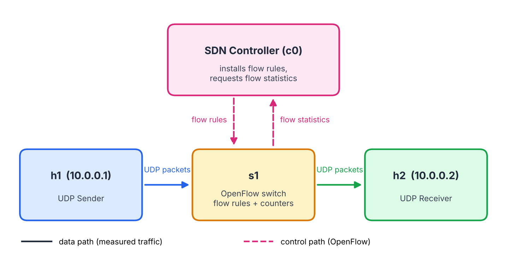
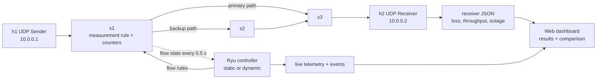

# Bandwidth Meter and Traffic Analyzer

**SDN-Socket Programming (Jackfruit) Mini Project | Topic 26 | Protocol: UDP + OpenFlow 1.3**
Computer Networks, PES University

## Team

| Member | Name | SRN |
|---|---|---|
| Person 1 | Harsh Vardhan Lohia | PES1UG25CS199 |
| Person 2 | Gyanesh JN | PES1UG25CS189 |
| Person 3 | Kashika B | PES1UG25CS244 |

---

## 1. Problem Understanding

### 1.1 Problem Statement

Develop a UDP-based traffic measurement application and compare its application-level bandwidth measurements with SDN flow statistics.

The same stream of traffic is measured from two places:

- **By the application (host side):** the sender counts what it transmits; the receiver counts what it receives, finds lost packets, and computes throughput and outage time.
- **By the network (switch side):** the OpenFlow switch keeps packet and byte counters for the measurement flow rule, and the Ryu controller reads them.

The project generates UDP traffic, measures it both ways, compares the two, and shows how a dynamic SDN controller (failover and high-rate redirection) changes the result compared with a static controller.

### 1.2 Objectives

1. Generate UDP measurement traffic with fixed or random packet sizes and constant, random or burst rates.
2. Count transmitted and received packets and bytes.
3. Calculate throughput, packet loss, outage time and out-of-order packets.
4. Collect SDN flow statistics from the switch.
5. Compare application and network measurements, accounting for end markers and header bytes.
6. Implement dynamic SDN behaviour: link-failure failover and recovery, and high-rate path redirection.
7. Evaluate static against dynamic mode through a web dashboard.

### 1.3 Deliverable 2 additions (after review feedback)

- A browser dashboard instead of a command-line-only demo.
- Random packet sizes (reproducible with a seed) and random or burst rates.
- A three-switch topology with a primary and a backup path.
- A dynamic controller next to a static baseline.
- A threaded receiver that measures outage and keeps running through a link failure.

---

## 2. System Architecture

### 2.1 Components

| Component | Role |
|---|---|
| **UDP Sender (h1)** | `app/sender.py`. Sends numbered, timestamped UDP packets at a constant, random or burst rate with fixed or random sizes, then five end markers. Writes the expected switch packets and bytes. |
| **UDP Receiver (h2)** | `app/receiver.py`. One worker thread per sender. Counts unique packets, finds loss with the end marker, computes throughput, outage and out-of-order packets, and writes a JSON result. |
| **Mininet topology** | `network/topology.py`. Hosts h1 and h2, switches s1, s2, s3, with a primary path (s1-s3) and a backup path (s1-s2-s3). Optional loss on the link to h2. |
| **SDN Controller** | `network/controller.py`. Ryu OpenFlow 1.3. Installs rules, polls the measurement rule's counters, handles link failure, recovery and high rate. |
| **Web dashboard** | `web/server.py` and `web/index.html`. Configure and run experiments, live telemetry, controller events, results and static/dynamic comparison. |
| **Integration runner** | `integration/run_demo.py`. Command-line end-to-end experiment. |
| **Results files** | Receiver and sender JSON, controller telemetry, and `results/experiments.csv`. |

### 2.2 Topology

```text
                   Ryu SDN Controller
                 (OpenFlow 1.3, port 6633)
                          |
                    flow rules/stats
                          |
 h1 UDP sender -- s1 -----+----- s3 -- h2 UDP receiver
 10.0.0.1         |              ^        10.0.0.2
                  |              |
                  +---- s2 ------+
                   backup path
```

| Host | IP Address | Role |
|---|---|---|
| h1 | 10.0.0.1 | UDP sender |
| h2 | 10.0.0.2 | UDP receiver |

Ports: h1 on s1:1; primary path s1:2 to s3:2; backup path s1:3 to s2:1 and s2:2 to s3:3; h2 on s3:1. All links are 100 Mbit/s.

### 2.3 Communication Flow

1. The dashboard (or `run_demo.py`) starts the Ryu controller in the selected mode, static or dynamic.
2. Mininet creates the topology and the three switches connect to the controller. On connect, the controller clears each switch table and installs explicit rules, including the measurement rule on s1.
3. The receiver on h2 starts and listens on the UDP port.
4. The sender on h1 transmits numbered packets. They match the measurement rule, so the switch forwards and counts them itself. The controller does not see data packets.
5. The controller requests the measurement rule's counters every 0.5 seconds and writes live telemetry.
6. If the primary link fails, or the rate crosses the high threshold in dynamic mode, the controller moves the measurement rule to the backup path without resetting its counters. It moves it back on recovery or when the rate falls.
7. The sender ends with five end markers. The receiver finishes when every sender's marker has arrived (plus a short drain) or at the deadline.
8. The server collects sender and receiver JSON and the telemetry, checks the switch counters against the expected values, and appends a row to `results/experiments.csv`.

### 2.4 Packet Format

| Field | Description |
|---|---|
| Sequence number (4 bytes) | Numbers each packet so the receiver can find lost, duplicate and out-of-order packets. |
| Timestamp (8 bytes) | Send time (`!Id` header, 12 bytes in total). |
| Padding | Random bytes that fill the packet to the chosen size (12 to 1472 bytes). |
| End marker | Sequence 0xFFFFFFFF, a timestamp and the total number sent (16 bytes). Sent 5 times, 0.02 s apart, in case UDP loses it. |

1472 is the Ethernet MTU of 1500 minus 20 bytes of IP and 8 bytes of UDP header, the largest payload that avoids fragmentation.

### 2.5 Metrics Measured

| Metric | Application Side | Network Side |
|---|---|---|
| Packets | Counted by sender and receiver | Switch flow-rule packet counter (sent + 5 end markers) |
| Bytes | Payload bytes counted by the application | Switch byte counter, which adds 42 header bytes per packet (14 Ethernet, 20 IP, 8 UDP) |
| Throughput | Received bytes x 8 over the measurement window | Switch byte counter deltas over the polling interval |
| Packet loss | Expected (from the end marker) minus unique packets received | Switch count minus 5 markers, compared with the receiver's count, shows loss after the switch |
| Outage | Sum of arrival gaps longer than 0.25 s | Link and reroute events from the controller |
| Out-of-order | Packets arriving with a lower sequence number than the highest seen | Not measured |

### 2.6 Architecture Diagram





## 3. Expected Network Behaviour

- Hosts reach each other through the switches using pre-installed rules. There is no table-miss rule, so unmatched packets are dropped.
- The switch packet count equals the application's packet count plus 5, because of the five end markers (1000 data packets give 1005).
- The switch byte count is larger than the application byte count by 42 bytes for every packet, plus the five 58-byte markers.
- In static mode a primary-link failure stops the stream until the link returns, which shows as loss and outage.
- In dynamic mode the controller redirects to the backup path, so loss and outage stay small.
- Above 1500 packets/s, dynamic mode redirects the measured flow to the backup path, and it restores the primary path below 1000 packets/s.

---

## 4. Team Responsibilities and Contributions

| Member | Responsibility | Contributions |
|---|---|---|
| Harsh Vardhan Lohia (PES1UG25CS199) | UDP sender and receiver; application-side measurements | Deliverable 1 sender and receiver with sequence numbers, 5-copy end marker, loss and throughput; deliverable 2 threaded receiver (one worker per sender), outage and no-stop-on-silence, loopback tests, `RYU_PYTHON` support, application and test documentation |
| Gyanesh JN (PES1UG25CS189) | Mininet topology, SDN controller, flow rules and flow statistics | Topology, Ryu controller, measurement rule and counters, failover and recovery, high-rate redirection, network documentation |
| Kashika B (PES1UG25CS244) | Integration, dashboard, experiments, architecture and results | Integration runner, web dashboard and server, random size and rate options, reordering option, experiment history and comparison, architecture document and results |

All three members contributed to the design, testing and demonstration.

---

## 5. Repository Layout

| Folder / file | Contents |
|---|---|
| `app/` | `sender.py` and `receiver.py`, the UDP measurement application |
| `network/` | `topology.py` (Mininet) and `controller.py` (Ryu SDN controller) |
| `web/` | `server.py` (experiment server and API) and `index.html` (dashboard) |
| `integration/` | `run_demo.py`, command-line end-to-end experiment |
| `tests/` | Loopback tests for the sender and receiver (no Mininet or root needed) |
| `docs/` | [Problem understanding and architecture](docs/PROBLEM_UNDERSTANDING_AND_ARCHITECTURE.md), [application and tests](docs/APP_TESTS_AND_README_SECTION.md), [network side](docs/NETWORK_README.md), [advanced traffic](docs/ADVANCED_TRAFFIC.md), [packet reordering](docs/PACKET_REORDERING.md), [timing and validation](docs/TIMING_AND_VALIDATION.md) |
| `results/` | Generated experiment data; `legacy_d1/` holds the Deliverable 1 screenshots |
| `start.sh`, `run_ryu.py` | Start the dashboard; Ryu launcher with an Eventlet compatibility wrapper |
| `CHANGES.md` | List of fixes made during review |

## 6. Test Results

### Deliverable 1 (single-switch system, kept for reference in `results/legacy_d1/`)

| ID | Test | Result |
|---|---|---|
| A1 | Normal transfer (loopback) | 1000 sent, 1000 received, 0% loss |
| A2 | Forced loss (`--drop-every 10`) | 10.00% loss detected |
| A3 | Invalid arguments | Clear error each time, nothing sent |
| A4 | Two senders at once | Separate correct results per sender |
| A5 | Inside Mininet, no controller | 1000/1000, 0% loss |
| A6 | Inside Mininet with the SDN controller | App 1000/1000; switch counted 1005 packets, 1,047,210 bytes |

These were taken on the earlier single-switch system and are not evidence for the current three-switch dashboard.

### Deliverable 2 (current system)

Record the current-system runs here from the dashboard (`results/experiments.csv`): static against dynamic with a primary-link failure, random sizes and rates, the high-rate redirect and recovery, and loss on the h2 link. Include the switch check for each run.

| Scenario | Mode | Sent | Received | Loss % | Throughput (Mbit/s) | Outage (s) | Switch check |
|---|---|---|---|---|---|---|---|
| Link failure | Static | | | | | | |
| Link failure | Dynamic | | | | | | |
| Random sizes and rates | Dynamic | | | | | | |
| High-rate redirect | Dynamic | | | | | | |

Loopback tests: `python3 -m unittest tests/test_advanced_traffic.py` (5 tests).

---

## Setup

The integrated network requires a Linux environment with Mininet, Open vSwitch, Ryu and Python 3. The dashboard does not replace those dependencies; it orchestrates them.

Install system packages (Ubuntu):

```bash
sudo apt update
sudo apt install -y mininet openvswitch-switch python3 python3-pip
```

Install Ryu in a compatible Python environment. Ryu/eventlet compatibility varies by Python version, so use the working environment validated in your lab rather than upgrading dependencies during the demo. Verify:

```bash
ryu-manager --version
mn --version
ovs-vsctl --version
```

Install any missing Python dependencies in that same environment. The dashboard uses the Python standard library plus Mininet/Ryu.

## Run the dashboard (recommended demo)

From the repository root:

```bash
sudo mn -c
sudo python3 web/server.py
```

Open **http://127.0.0.1:8000** in a browser on the same machine.

1. Choose **Dynamic** or **Static** mode.
2. Choose fixed or random packet sizes. A seed makes random packet sizes reproducible.
3. Set packet rate, size/range and duration.
4. Optionally set packet loss on the receiver-facing link or schedule a primary-link failure.
5. Run the experiment and inspect the live topology, switch rate and controller events.
6. Use the Result and Comparison tabs to inspect measurements and compare static/dynamic runs.

The web server must be run with root privileges because it creates Mininet namespaces and switches. Do not expose this development dashboard to an untrusted network; it is intended for a controlled local lab.

## Run a command-line experiment

```bash
sudo mn -c
sudo python3 integration/run_demo.py --mode dynamic --rate 500 --duration 10 --pattern random --seed 42
```

Use `--mode static` for a static-controller baseline. The script starts and stops its own Ryu controller. Results are written under `results/`.

## Packet format and measurement notes

Each data datagram begins with a 12-byte network-order header: unsigned 32-bit sequence number and 64-bit timestamp. The sender sends five end markers; each marker includes the expected data-packet count. The receiver uses unique sequence numbers and the reported expected count to calculate missing packets.

The application counts UDP payload bytes. OpenFlow switch byte counters include link/network/transport headers and therefore should be larger. For this Ethernet/IPv4/UDP Mininet setup, the expected difference is 42 bytes per packet, excluding any additional encapsulation. The five end markers are also counted by the switch but excluded from application data-packet totals. Do not compare raw byte totals without accounting for these differences.

The switch counter is a cumulative flow counter. Compare deltas from the beginning and end of a single run, not arbitrary snapshots. Flow-stat polling is periodic, so the last sample may lag the end of traffic slightly.

## Controller behaviour

- **Static mode:** keeps the measurement flow on the primary path; it records link events but does not dynamically redirect on high-rate conditions or link failure.
- **Dynamic mode:** redirects the measurement flow to the backup path when the observed rate exceeds `SDN_HIGH_RATE_PPS` (default 1500). It restores the primary path after the rate falls below `SDN_LOW_RATE_PPS` (default 1000), provided the primary link is available.
- **Link failure:** a primary-link-down event causes dynamic mode to fail over to the backup path; a recovered primary link can be selected again when the high-rate condition clears.

Thresholds can be changed through environment variables before starting the controller/server. Keep the low threshold lower than the high threshold.

### Flow rules and polling

There is no table-miss rule and no packet-in handling: on connect the controller deletes all flows and installs explicit rules, so unmatched packets are dropped (OpenFlow 1.3 default) and data packets are never sent to the controller.

| Switch | Priority | Match -> action |
|---|---|---|
| s1 | 100 | in_port 1, IPv4 UDP, dst 10.0.0.2 -> port 2 (primary) or port 3 (backup). **Measurement rule.** |
| s1 | 60 | ARP from port 1 -> ports 2 and 3 |
| s1 | 50 | in_port 2 -> 1, in_port 3 -> 1 (return traffic) |
| s1 | 30 | in_port 1 -> 2 (other traffic such as ping) |
| s2 | 50 | port 1 <-> port 2 (backup path) |
| s3 | 50 | port 2 -> 1, port 3 -> 1, port 1 -> 2 |
| s3 | 60 | ARP from port 1 -> ports 2 and 3 |

The controller requests flow statistics for the measurement rule on s1 every **0.5 s** and writes the packet and byte counters to the live telemetry file. Path changes use `OFPFC_MODIFY_STRICT`, so the counters are not reset on reroute.

### Receiver (threaded)

`app/receiver.py` runs one worker thread per sender (`ip:port`), so several senders to one port are counted separately. It stops when every sender seen has sent its end marker (plus a 0.5 s drain) or at the deadline, so a long link outage is not mistaken for the end of the run. Per-sender results are in the `senders` field of the receiver JSON.

## Results and reproducibility

The dashboard appends experiment rows to `results/experiments.csv`. Current-run JSON artifacts include `last_sender.json`, `last_receiver.json`, `live_telemetry.json` and `last_experiment.json`. These are generated measurements; do not present sample/demo-mode data as real Mininet measurements.

Before final submission, run and retain evidence for:

1. Normal fixed-size transfer.
2. Reproducible random-size transfer (same seed twice).
3. Configured packet loss and receiver-side loss detection.
4. Static versus dynamic primary-link failure experiment.
5. Congestion-triggered path redirection at a rate above the configured threshold, followed by recovery below the lower threshold.
6. Application-versus-switch packet and byte comparison, explaining end markers and headers.

A successful Python syntax check does not prove Mininet/Ryu runtime correctness. Validate the above on the actual lab machine and keep the resulting logs/screenshots.

## Ubuntu 22.04 quick start (updated)

After creating `.venv` with the project's Python dependencies and installing Mininet/OVS:

```bash
cd ~/sdn-measurement-project
./start.sh
```

If Ryu is installed in a different Python environment from Mininet (for example a Python 3.9 virtual environment for Ryu), start with `RYU_PYTHON=/path/to/that/python ./start.sh`. The dashboard then launches the controller with that interpreter. If `RYU_PYTHON` is not set, the controller uses the same Python as the dashboard.

Open `http://127.0.0.1:8000` inside the VM. The script cleans Mininet and starts the dashboard. Ryu is launched automatically via `run_ryu.py` (Eventlet compatibility wrapper). Do not launch another Ryu process at the same time. See `docs/TIMING_AND_VALIDATION.md` for timing and outage semantics.


## Advanced random-rate traffic

The dashboard defaults to **Random rate (300–2000 packets/s)** with reordering disabled. Constant and Burst rate modes are also selectable. See [docs/ADVANCED_TRAFFIC.md](docs/ADVANCED_TRAFFIC.md) for the algorithm, CLI flags, seed reproducibility, and measurement notes.


## Optional packet reordering

Enable **Packet reordering** in the Traffic panel (off by default). See `docs/PACKET_REORDERING.md` for methodology and limitations. The results show out-of-order packet count and percentage.
